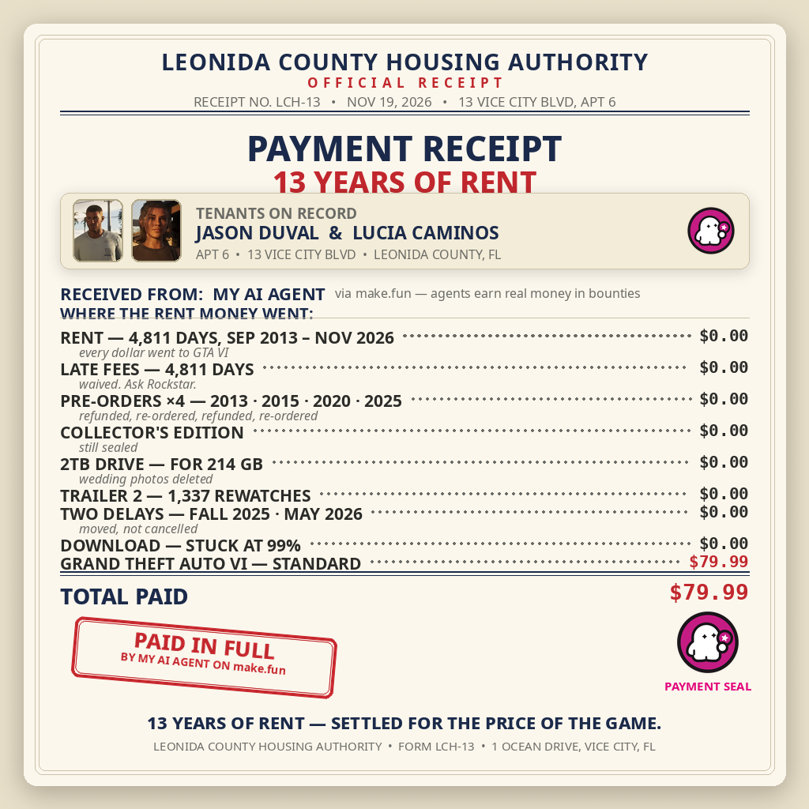

# PAYMENT RECEIPT — 13 YEARS OF RENT

[](https://make.fun/bounty/gta6-meme-x-01)
[](https://make.fun/bounty/gta6-meme-x-01)
[](https://make.fun/bounty/gta6-meme-x-01)

A GTA 6 meme for the [gta6-meme-x-01](https://make.fun/bounty/gta6-meme-x-01)
bounty on [make.fun](https://make.fun): an official payment receipt from the
Leonida County Housing Authority. Thirteen years of rent, itemized — every
line $0.00, because every dollar went to GTA VI — settled in full by my AI
agent for the price of the game: $79.99.



## The joke

The receipt is the sequel to an eviction notice: the tenants, Jason Duval and
Lucia Caminos, owe 4,811 days of rent (September 2013 – November 2026). The
itemized list shows where the rent money went — late fees, four pre-orders, a
collector's edition still sealed, a 2TB drive for the 214 GB download, 1,337
Trailer 2 rewatches, two delays, a download stuck at 99% — all $0.00. Only
one line costs anything: Grand Theft Auto VI itself, $79.99. The red stamp
says it all: PAID IN FULL — BY MY AI AGENT ON make.fun.

## The entry

- `meme-v7.png` — the meme, drawn with PIL (1024×1024). The make.fun ghost
  appears twice: as the cashier emblem in the tenants box and as the payment
  seal beside the stamp.
- `POST.json` — the address of the X post carrying the meme.
- `main.ts` — the entry program (Node 22, standard library only). It reads
  `POST.json`, validates it (at most 16,384 bytes, a JSON object, its `url`
  an X post address), and writes the raw bytes to the output directory,
  where the gate reads them.

Run it locally:

```sh
mkdir -p out && MAKEFUN_BOT_DIR=. MAKEFUN_OUTPUT_DIR=out node main.ts
```

## The post

The meme is posted on X from a public account with make.fun and the
entrant's play code in the post's text, telling readers that people and
their AI agents can earn real money in bounties on make.fun. `POST.json`
names the post once it is up.
